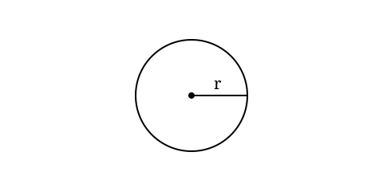

+++
title = 'Hello, World'
date = 2026-06-29T12:00:00+03:00
draft = false
type = 'post'
description = 'A demo page: combinatorics, set theory, logic gates and code from my other projects.'
tags = ['math', 'rust', 'python', 'logic', 'demo']
categories = ['meta']
translationKey = 'hello-world'
+++

This is a demo page to check how formulas, tables and code render. Once I write the first real article, this one goes to the archive. (No)

## Combinatorics

The binomial coefficient counts the ways to choose $k$ elements out of $n$, order ignored:

$$
\binom{n}{k} = \frac{n!}{k!\,(n-k)!}
$$

If order matters, these are arrangements; if we take all $n$ elements, permutations:

$$
A_n^k = \frac{n!}{(n-k)!}, \qquad P_n = n!
$$

For example, $\binom{5}{2} = 10$, and $P_5 = 120$.

The binomial theorem ties it all together:


I haven't even shown you the trinomial yet:

$$
\begin{aligned}
(a+b+c)^2 &= a^2 + b^2 + c^2 \\
&\quad + 2(ab + bc + ca)
\end{aligned}
$$


$$
(x+y)^n = \sum_{k=0}^{n} \binom{n}{k} x^{n-k} y^k
$$

## Sets

A set can be given by listing its elements or by a defining property:

$$
A = \{\, x \in \mathbb{Z} \mid x^2 < 10 \,\} = \{-3,-2,-1,0,1,2,3\}
$$

The basic operations are intersection $A \cap B$, union $A \cup B$, difference $A \setminus B$ and symmetric difference $A \triangle B$. The size of the power set grows as a power of two:

$$
|\mathcal{P}(A)| = 2^{|A|}
$$

De Morgan's laws connect complement with union and intersection:

$$
\overline{A \cup B} = \overline{A} \cap \overline{B},
\qquad
\overline{A \cap B} = \overline{A} \cup \overline{B}
$$

## Binary gates

Two boolean inputs give four input combinations. Here is the truth table of the basic two-input gates:

| $A$ | $B$ | AND | OR | XOR | NAND | NOR | XNOR |
|:---:|:---:|:---:|:---:|:---:|:----:|:---:|:----:|
| 0 | 0 | 0 | 0 | 0 | 1 | 1 | 1 |
| 0 | 1 | 0 | 1 | 1 | 1 | 0 | 0 |
| 1 | 0 | 0 | 1 | 1 | 1 | 0 | 0 |
| 1 | 1 | 1 | 1 | 0 | 0 | 0 | 1 |

Formally: $A \land B$, $A \lor B$, $A \oplus B = (A \lor B) \land \lnot(A \land B)$, $\mathrm{NAND} = \lnot(A \land B)$, $\mathrm{NOR} = \lnot(A \lor B)$, $A \leftrightarrow B = \lnot(A \oplus B)$. XOR and AND make a half adder:

$$
S = A \oplus B, \qquad C_{\text{out}} = A \land B
$$

## Code from my projects

### Primality test in Rust

From `prime_spiral` — a naive but honest divisor search in $O(\sqrt{n})$:

```rust
fn is_prime(n: u64) -> bool {
    if n < 2 { return false; }
    if n == 2 { return true; }
    if n % 2 == 0 { return false; }
    let mut i = 3;
    while i * i <= n {
        if n % i == 0 { return false; }
        i += 2;
    }
    true
}
```

### The same thing in Python

The version from `graph.py`, which draws a polar spiral of primes:

```python
def is_prime(n):
    """Fast primality check."""
    if n < 2: return False
    if n == 2: return True
    if n % 2 == 0: return False
    for i in range(3, int(n**0.5) + 1, 2):
        if n % i == 0: return False
    return True
```

### Deterministic randomness

`Hollow_Burrow` needs a reproducible world: same seed, same events. So instead of `rand` it uses a small xorshift:

```rust
impl SimRng {
    pub fn next_unit(&mut self) -> f32 {
        let mut x = self.state;
        x ^= x << 13;
        x ^= x >> 17;
        x ^= x << 5;
        self.state = x;

        (x >> 8) as f32 / (1u32 << 24) as f32
    }
}
```

## Images

Files live in the article folder. The cover is `cover.svg` (picked up automatically). An image can be inserted with plain markdown or with the theme shortcode:




