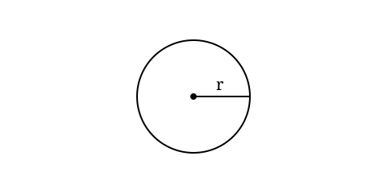

+++
title = 'Привет, мир'
date = 2026-06-29T12:00:00+03:00
draft = false
type = 'post'
description = 'Демо-страница: комбинаторика, теория множеств, логические ворота и код из моих проектов.'
tags = ['math', 'rust', 'python', 'logic', 'demo']
categories = ['meta']
translationKey = 'hello-world'
+++

Это демо-страница, чтобы проверить вёрстку формул, таблиц и кода. Когда напишу первую настоящую статью, отправлю её в архив. (Нет)

## Комбинаторика

Число сочетаний — сколькими способами можно выбрать $k$ элементов из $n$, не учитывая порядок:

$$
\binom{n}{k} = \frac{n!}{k!\,(n-k)!}
$$

Если порядок важен, это уже размещения, а если выбираем все $n$ элементов — перестановки:

$$
A_n^k = \frac{n!}{(n-k)!}, \qquad P_n = n!
$$

Например, $\binom{5}{2} = 10$, а $P_5 = 120$.

Бином Ньютона собирает всё это вместе:


Это я вам ещё трином Ньютона не показал:

$$
(a + b + c)^n = \sum_{i + j + k = n} \frac{n!}{i! \, j! \, k!} a^i b^j c^k
$$


$$
(x+y)^n = \sum_{k=0}^{n} \binom{n}{k} x^{n-k} y^k
$$

## Множества

Множество можно задать перечислением или через характеристическое свойство:

$$
A = \{\, x \in \mathbb{Z} \mid x^2 < 10 \,\} = \{-3,-2,-1,0,1,2,3\}
$$

Основные операции: пересечение $A \cap B$, объединение $A \cup B$, разность $A \setminus B$ и симметрическая разность $A \triangle B$. Мощность булеана растёт как степень двойки:

$$
|\mathcal{P}(A)| = 2^{|A|}
$$

А законы де Моргана связывают дополнение с объединением и пересечением:

$$
\overline{A \cup B} = \overline{A} \cap \overline{B},
\qquad
\overline{A \cap B} = \overline{A} \cup \overline{B}
$$

## Бинарные ворота

Две логические переменные дают четыре набора входов. Вот таблица истинности основных двухвходовых ворот:

| $A$ | $B$ | AND | OR | XOR | NAND | NOR | XNOR |
|:---:|:---:|:---:|:---:|:---:|:----:|:---:|:----:|
| 0 | 0 | 0 | 0 | 0 | 1 | 1 | 1 |
| 0 | 1 | 0 | 1 | 1 | 1 | 0 | 0 |
| 1 | 0 | 0 | 1 | 1 | 1 | 0 | 0 |
| 1 | 1 | 1 | 1 | 0 | 0 | 0 | 1 |

Формально: $A \land B$, $A \lor B$, $A \oplus B = (A \lor B) \land \lnot(A \land B)$, $\mathrm{NAND} = \lnot(A \land B)$, $\mathrm{NOR} = \lnot(A \lor B)$, $A \leftrightarrow B = \lnot(A \oplus B)$. Из XOR и AND собирается полусумматор:

$$
S = A \oplus B, \qquad C_{\text{out}} = A \land B
$$

## Код из моих проектов

### Проверка простоты на Rust

Из проекта `prime_spiral` — наивный, но честный перебор делителей за $O(\sqrt{n})$:

```rust
fn is_prime(n: u64) -> bool {
    if n < 2 { return false; }
    if n == 2 { return true; }
    if n % 2 == 0 { return false; }
    let mut i = 3;
    while i * i <= n {
        if n % i == 0 { return false; }
        i += 2;
    }
    true
}
```

### То же самое на Python

Версия из `graph.py`, которая рисует полярную спираль простых чисел:

```python
def is_prime(n):
    """Быстрая проверка числа на простоту."""
    if n < 2: return False
    if n == 2: return True
    if n % 2 == 0: return False
    for i in range(3, int(n**0.5) + 1, 2):
        if n % i == 0: return False
    return True
```

### Детерминированный рандом

В `Hollow_Burrow` мне нужен воспроизводимый мир: одинаковый сид — одинаковые события. Поэтому вместо `rand` там маленький xorshift:

```rust
impl SimRng {
    pub fn next_unit(&mut self) -> f32 {
        let mut x = self.state;
        x ^= x << 13;
        x ^= x >> 17;
        x ^= x << 5;
        self.state = x;

        (x >> 8) as f32 / (1u32 << 24) as f32
    }
}
```

## Картинки

Файлы лежат в папке статьи. Обложка — `cover.svg` (подхватывается автоматически). Картинку можно вставить обычным markdown или шорткодом темы:




